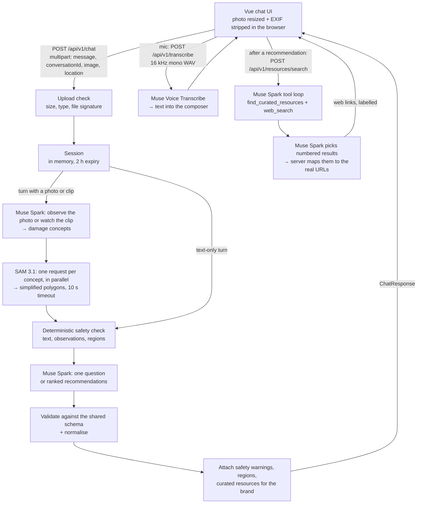

# SecondLife AI ♻️

An AI assistant that helps people decide what to do with any old electrical or electronic device, from earbuds, power banks and phones to TVs, washing machines and air conditioners: **repair, reuse, donate, resell or recycle**. Describe the device, upload a photo or short clip, or just speak, answer a few questions, and get ranked recommendations, safety guidance and links to trusted resources. The MVP focuses on **India**.

SecondLife AI is being built for the [Meta Global AI Developer Hackathon](#hackathon) and uses **Meta models only**: Muse Spark for reasoning, tool calling, web search and watching video clips, SAM 3.1 for highlighting damage on the user's photo, and Muse Voice Transcribe for speaking instead of typing.

> **Status:** the chat experience, safety layer, curated resources and the Meta model integrations (Muse Spark, SAM 3.1 and Muse Voice Transcribe on the Meta Model API) are built and tested against the live API. Video, voice input and Hindi support have been tested against the API but not yet on real phones. A public deployment, screenshots and a demo video are still to come.

## The problem

Old phones, laptops, TVs, chargers and appliances end up in drawers, store rooms or general waste because their owners don't know what else to do with them. Is a cracked screen worth fixing? Will anyone buy a phone that won't turn on? Is an 8-year-old washing machine worth repairing? Is a swollen battery, or an iron that gives a small shock, dangerous? Where is an authorised e-waste recycler? Without clear answers, devices that could be repaired, reused, donated or resold are thrown away, and hazardous ones are handled unsafely.

## The solution

SecondLife AI turns that decision into a short conversation:

1. **Describe the device, upload a photo or a short video, or both.** Type, or tap the mic and speak, in English, Hindi or Hinglish. "My laptop won't turn on" is enough to start.
2. **See what the assistant spotted.** On a photo, damage such as a screen crack or a swollen battery is outlined directly on the image.
3. **Answer a question or two.** The assistant asks at most three, and only when the answer could change its advice. Each comes with one-tap quick replies.
4. **Get ranked recommendations.** Each option includes a reason, numbered next steps, a confidence level and its limitations.
5. **Take the next step.** Curated repair, resale, donation and recycling resources for the device's brand appear under the relevant recommendation. A few seconds later, official pages found by web search (such as the brand's own India service or take-back page) are added, clearly labelled. Repair shops and drop-off points near you are listed too.
6. **Earn points for doing the right thing.** Hand the device to a partner shop for repair, donation or recycling, show them a one-time code, and once they confirm, points land in your wallet. Partners offer rewards you can spend them on. You can also record what you decided to do.

## Key features

### Implemented

- **Muse Spark** (`muse-spark-1.3` on the Meta Model API) reads the photo, decides which damage to outline, asks follow-up questions and returns ranked recommendations as structured output.
- **SAM 3.1** (`sam-3.1` on the Meta Model API) outlines the damaged parts Muse Spark names, on any user photo.
- **Web search with tool calling.** After a recommendation, Muse Spark checks the curated list with a `find_curated_resources` function tool, then uses web search only for the gaps, such as the brand's official India service-centre locator or e-waste take-back page. The model never writes a link: it picks numbered search results, and the server uses the real URL from that result.
- **Chat workspace** with suggested prompts, quick-reply chips, a typing indicator, follow-up questions after a recommendation, a "New conversation" control and a points button in the header. Built mobile-first.
- **Short video clips** (MP4 or MOV, up to 30 seconds and 20 MB) for problems a photo can't show, such as a flickering screen. Muse Spark watches the clip, and SAM 3.1 outlines the damage on a frame the browser takes from the middle of it. Location and other personal metadata are removed from the clip on the device before upload, and again on the server.
- **Speak instead of typing.** A mic button records up to a minute, converts it to WAV in the browser and sends it to Muse Voice Transcribe. The transcript lands in the text box to check and edit before sending.
- **English, Hindi and Hinglish.** Muse Spark replies in the language and script the user writes or speaks in. The deterministic safety check also understands Hindi and Hinglish hazard words (for example "battery phool gayi", "बैटरी फूल गई"), including Hindi-style negation ("garam nahi hai").
- **Photo upload** by file picker, drag-and-drop or paste. The browser resizes the photo (longest side at most 1600 px) and re-encodes it as JPEG, which strips EXIF metadata such as GPS location. HEIC photos the browser can't open get a clear message. The server checks size, type and file signature, and keeps images in memory only.
- **Optional location, worked out on the device.** "Use my current location" asks the browser for its position, then finds the nearest Indian town, its district and its state on the device, using a bundled GeoNames table that loads only when needed. Only the town, district and state are sent, never coordinates, and positions outside India are refused. Users can instead pick a state and type a city. The area is remembered on the device until removed, passed to the assistant as context, and used to put state-specific resources first.
- **Damage overlay.** Damage regions from SAM 3.1 are drawn as translucent, labelled masks on an SVG layer over the user's own photo, with a hide/show toggle. Three bundled sample photos (cracked phone, swollen battery, old tablet) let you try it without a broken device.
- **Bounded questioning.** At most three follow-up questions, one per turn. If the user doesn't know an answer, the assistant recommends anyway and states the uncertainty.
- **Ranked recommendations** across repair, reuse, donate, resell, recycle and "stop using it": a primary card for the top option and expandable cards for alternatives.
- **Deterministic safety layer**, independent of the model. It detects battery, fire and electrical hazards (swelling, smoke, sparks, a burning smell, electric shocks, melted wiring, a battery or gas leak) in what the user writes, in the photo observations and in highlighted regions. It handles simple negation, so "it's not hot" doesn't trigger, and ignores everyday appliance complaints such as an AC blowing hot air or a washing machine leaking water. On a match it always shows a safety banner and puts "stop using it" first. It removes DIY battery advice from every reply. The model's instructions add appliance-specific rules: never open a microwave, CRT TV or anything mains-powered, and leave fridge and AC refrigerant gas to technicians.
- **Privacy reminder** (back up, sign out, remove SIM and memory cards, factory reset) for devices that store personal data, whenever donating or reselling is recommended.
- **Curated resources** for India plus a few global guides, shown under the recommendation they support and labelled as curated. Brand-specific links (for example Samsung or Apple service pages) appear only when the device's brand is known and matches, detected from the photo or the conversation. Links found by web search follow, labelled "Found on the web — check before visiting" with their source. The assistant never writes links itself.
- **Repair shops and drop-off points near you.** Under the repair, donate and recycle recommendations, partners in the user's district and state are listed with the devices they handle and, for real partners, call and WhatsApp buttons. The listings in this demo are fictional, always labelled "Demo", and have no contact details.
- **Points and rewards.** The user picks a partner and gets a one-time handover code (for example `SL-7K4Q9X`). When the partner enters it with their PIN, the user's wallet earns 500 points for a donation, 50 for recycling or 25 for a repair. Partners offer rewards such as a free phone health check; redeeming gives a code the partner marks as used. Points are never awarded on the user's word alone. Points from demo partners are kept apart as "demo points" and only buy demo rewards, so the public demo can't mint points a real shop would have to honour.
- **Partner page** (`#/partner`). Repair shops and collection points can ask to be listed, with explicit consent to show their name, area and phone number, and get a PIN shown once. Listings appear only after approval. Logged-in partners confirm handover codes, mark reward codes as used and offer rewards. A "Try the demo" box lists the demo partners and their shared demo PIN.
- **Outcome recording.** Users can record whether they repaired, reused, donated, sold or recycled the device, or are still deciding. A choice is acknowledged with a short celebration, a note on why it helps, and a reminder of the next practical step (such as wiping data before donating).
- **Strict response contract.** Every assistant turn is validated against one Zod schema shared by the server and the client, then normalised.
- **Resilient UX.** Inline errors with a Retry button that resends the same message and photo. Expired conversations restart cleanly.

### Planned

- Public deployment, screenshots and a demo video.
- State-level curated resources, such as each State Pollution Control Board's list of authorised e-waste recyclers.

## Screenshots and demo

| | |
|---|---|
| Screenshots | Not added yet |
| Live demo | Not deployed yet |
| Demo video (3 min) | Not recorded yet |

## Technology stack

| Layer | Technology |
|---|---|
| Frontend | Vue 3 (`<script setup>`), TypeScript, Vite 8 |
| Styling | Tailwind CSS 4, Lucide icons |
| Backend | Node.js 22, Express 5, Multer (in-memory uploads) |
| API contract | Zod 4 schemas in `shared/schemas.ts`, imported by both sides |
| AI | Meta models only, on the Meta Model API: Muse Spark (Chat Completions and Responses APIs), SAM 3.1 and Muse Voice Transcribe, called with plain `fetch`; Meta's `@meta-sam/parser` decodes SAM masks |
| Tooling | tsx (dev server), esbuild (server build), vue-tsc, concurrently |

## Architecture

One repository and one deployable Node service: Express serves the API and, in production, the built Vue app.



**Frontend and backend.** The client calls a REST API under `/api/v1`. In development, Vite proxies `/api` to the Express server on port 3001. In production, Express also serves `client/dist`, so everything runs on one origin.

**AI providers.** Three small interfaces in `server/src/providers/types.ts` keep the models swappable per host: `AssessmentProvider` (`observeImage`, `respond`) for Muse Spark, `SegmentationProvider` (`segment`) for SAM 3.1, and `ResourceFinder` (`find`) for the web search. Model calls happen on the server only, so credentials never reach the browser. A segmentation or web search failure never blocks the conversation: the photo is simply shown without highlights, and the curated links stand on their own.

**How a turn is produced** (`server/src/services/conversation.service.ts`):

1. Load the session, or create one if the ID is missing or expired. Work on a copy, so a failed request can be retried cleanly.
2. If there is a photo: get device observations, send the named damage concepts to segmentation, and keep regions scoring at least 0.5. A short summary of the regions is kept for later turns. The image itself is never stored.
3. Run the safety check over the user's messages, the observations and the regions.
4. Ask the assessment provider for the next turn: a question (`gathering`), ranked recommendations (`recommending`) or an answer about an earlier recommendation (`follow_up`).
5. Validate and normalise the turn, apply the safety rules, attach curated resources for the recommended actions and the device's brand, save the session and return.
6. After a recommending turn, the client asks `POST /resources/search` for extra official links and appends them when they arrive. The result is cached on the session until the next recommendation.

### API

All endpoints are under `/api/v1`. Errors use the shape `{ error: { code, message } }` with a user-safe message.

| Method | Path | Description |
|---|---|---|
| `GET` | `/health` | `{ ok, provider, isMock, supportsImages, supportsVideo, speechToText, webSearch }`, used for the header badge and to decide which inputs and extras to offer |
| `POST` | `/chat` | `multipart/form-data` with `message`, optional `conversationId`, optional `image`, optional `video` (MP4 or MOV, up to 30 s; `image` is then its poster frame) and optional `location` (JSON: `{ state, district, place, source }`, where `state` is a two-letter code such as `KL`; a malformed value is ignored). Returns the assistant turn, resources, damage regions and provider names |
| `GET` | `/resources?region=IN&action=recycle` | Curated resources, optionally filtered by region and action. A state region such as `IN-KL` also includes `IN` and global entries, most specific first |
| `POST` | `/resources/search` | `{ conversationId }`. Searches the web for official pages that the latest recommendation's curated links lack. Returns `{ resources, searched }`, where every resource has `source: "web"` and its URL comes from a real search result. Takes several seconds; repeat calls are served from the session |
| `POST` | `/transcribe` | `multipart/form-data` with one `audio` file: mono 16-bit PCM WAV at 16 or 24 kHz, up to 60 s. Returns `{ text }` |
| `GET` | `/partners?state=KL&district=Wayanad&service=repair` | Approved partners, same district first (at most 5 when a state is given) |
| `POST` | `/partners` | A partner registration (with `consent: true`). Returns `{ id, pin, status: "pending" }`; the PIN is shown once and stored only as a salted hash |
| `GET` | `/rewards?state=KL` | Rewards from approved partners, the user's state first |
| `GET` | `/wallet` | The wallet for the `X-Wallet-Id` header: `{ points, demoPoints, history }` |
| `POST` | `/handovers` | `{ action, partnerId, conversationId? }` with `X-Wallet-Id`. Returns a one-time code valid for 1 year |
| `GET` | `/handovers/:code` | The code's status (`open`, `confirmed`, `expired`), for its own wallet only |
| `POST` | `/rewards/:id/redeem` | Spends points (or demo points for a demo reward) and returns a reward code |
| `POST` | `/partner/login`, `/partner/handovers/confirm`, `/partner/redemptions/use`, `/partner/rewards` | Partner tools; every request carries `{ partnerId, pin }`. Five wrong PINs in 10 minutes lock the partner out for a while |
| `GET` | `/partner/demo` | The demo partners and their shared PIN, for the "Try the demo" box |
| `GET`/`POST` | `/admin/partners`, `/admin/partners/:id/approve`, `/admin/partners/:id/reject` | Moderation of registrations, with `Authorization: Bearer <ADMIN_TOKEN>`. Off when `ADMIN_TOKEN` is unset |
| `POST` | `/outcomes` | Records `{ conversationId, outcome }` (`repaired`, `reused`, `donated`, `sold`, `recycled`, `undecided`) |

## Getting started

### Prerequisites

- Node.js 22 or later
- npm (included with Node.js)

### Install

```bash
git clone https://github.com/vonnue-akhil/SecondLife-AI.git
cd SecondLife-AI
npm install
```

### Configure

```bash
cp .env.example .env
```

Every setting has a working default. To run on Meta's models, add your Meta Model API key as `MODEL_API_KEY` and switch on the Muse Spark and SAM 3.1 providers as described in [`.env.example`](.env.example) (`SEGMENTATION_PROVIDER=sam3` for SAM 3.1). Web search, video clips and the mic button turn on with Muse Spark on the same key.

### Run in development

```bash
npm run dev
```

This starts both parts:

- Client (Vite): http://localhost:5173. Open this one.
- API (Express, auto-reloads): http://localhost:3001/api/v1/health

To run them separately in two terminals: `npm run dev:server` and `npm run dev:client`.

Try these demo journeys:

- Tap the **Cracked phone** sample photo and send it.
- Type "My laptop won't turn on".
- Type "The back of my phone is bulging".
- Tap the **Old tablet** sample photo and send "Still works, I just upgraded.", then record that you donated it.
- Set your area to Wayanad, Kerala (the location button under the message box), get a recommendation to donate or recycle, and tap **Get my handover code** at a demo partner. Then open `#/partner` in another tab, log in as that demo partner with the demo PIN shown there, and confirm the code. Your demo points appear under the points button, ready to spend on a demo reward.

### Production build

```bash
npm run build
npm start
```

This serves the client and the API together on `PORT` (default 3001), at http://localhost:3001.

### Checks

```bash
npm run typecheck   # vue-tsc for the client, tsc for the server
```

There is no automated test suite.

## Environment variables

Settings are read from `.env` in the repository root; [`.env.example`](.env.example) lists every one. A blank value counts as unset. Never commit `.env`; it is already in `.gitignore`. The server validates all values at startup and exits with a clear message if one is invalid.

| Variable | Default | Purpose |
|---|---|---|
| `MUSE_HOST` | `meta` | Where Muse Spark runs: `meta` (Meta Model API) or `baseten` (Muse Spark Open) |
| `MODEL_API_KEY` | — | Meta Model API key, used for Muse Spark, web search, SAM 3.1 and Muse Voice Transcribe. Server-side only |
| `META_API_BASE_URL` | `https://api.meta.ai/v1` | Meta Model API base URL |
| `META_MODEL_ID` | `muse-spark-1.3` | Muse Spark model ID on the Meta host |
| `BASETEN_API_KEY` | — | Baseten API key. Server-side only |
| `BASETEN_BASE_URL` | `https://inference.baseten.co/v1` | Baseten base URL |
| `BASETEN_MODEL_ID` | `meta-models/muse-spark-open-1026` | Muse Spark Open model ID on Baseten (to be confirmed) |
| `SEGMENTATION_PROVIDER` | — | `sam3` outlines damage on any photo with SAM 3.1 on the Meta Model API (needs `MODEL_API_KEY`) |
| `SAM_MODEL_ID` | `sam-3.1` | SAM model ID on the Meta Model API |
| `MAX_UPLOAD_MB` | `8` | Maximum image upload size (1–20) |
| `MAX_VIDEO_MB` | `20` | Maximum video clip size (1–40). Clips must also be at most 30 seconds |
| `ASR_MODEL_ID` | `muse-voice-transcribe-1.0` | Muse Voice Transcribe model ID for the mic button |
| `DATA_DIR` | `data` | Folder for the partner programme's JSON data file (partners, wallets, handover and reward codes). Keep it on a persistent disk |
| `DEMO_PARTNER_PIN` | `demo-2026` | PIN for the fictional demo partners, shown on the partner page. Blank turns the demo partner tools off |
| `ADMIN_TOKEN` | — | Bearer token for approving partner registrations. Admin routes are off when unset |
| `PORT` | `3001` | Port for the API, and for the production server |

## AI integration

### Models

SecondLife AI uses **Meta models only**, all on the [Meta Model API](https://dev.meta.ai/docs) with one key, chained in one bounded loop:

| Role | Meta model | Use |
|---|---|---|
| Reasoning and conversation | Muse Spark (`muse-spark-1.3`) | Reads the photo, asks follow-ups, returns ranked recommendations as structured output |
| Damage localisation | SAM 3.1 (`sam-3.1`) | Outlines the damaged parts Muse Spark names, for the photo overlay |
| Tool use | Muse Spark tool calling | `find_curated_resources(action, brand)` looks up the hand-checked links before searching |
| Grounded resources | Muse Spark web search | Finds official pages the curated list lacks; only real search-result URLs are shown |
| Video understanding | Muse Spark | Watches a short clip, for problems that show over time |
| Speech to text | Muse Voice Transcribe (`muse-voice-transcribe-1.0`) | Turns the user's speech into editable text |

How the code uses them, with details confirmed from [Meta's developer docs](https://dev.meta.ai/docs):

- **Muse Spark model:** `muse-spark-1.3`, the version Meta recommends for new work. We avoid the cheaper "contributor" variants, which allow Meta to train on what is sent, because requests include users' photos.
- **Conversation:** the OpenAI-compatible Chat Completions endpoint (`POST /v1/chat/completions`). Photos go in as base64 data URLs. `response_format` carries a strict JSON schema generated from the shared Zod schemas (`DeviceObservations` for the photo, `AssistantTurn` for each reply). Replies are still validated, and an invalid one gets one repair request listing the validation errors. Muse Spark always reasons; the server asks for `reasoning_effort: "low"` to keep turns quick.
- **Damage concepts:** SAM 3.1 matches a short noun phrase naming a part rather than a defect, so the photo prompt asks Muse Spark for phrases such as "cracked phone screen", "shattered glass" or "phone back cover" (for a lifted back), never a bare "crack".
- **Segmentation:** SAM 3.1 runs on the Responses API (`POST /v1/responses`), one streamed request per concept (up to four, in parallel), with compact `one_bit` masks and per-match confidence. Meta's [`@meta-sam/parser`](https://www.npmjs.com/package/@meta-sam/parser) decodes each mask. The server maps it from its bounding box back to image pixels, simplifies the outline, drops tiny fragments and keeps matches with confidence of at least 0.5. The overlay draws holes correctly.
- **Tool calling and web search:** both run on the Responses API, because web search is not available on Chat Completions. The resource finder (`server/src/providers/muse/resource-finder.ts`) works in two steps:
  1. A tool loop of at most a few rounds, with the `find_curated_resources` function tool and the built-in `web_search` tool. Search is biased to the user's state and town when shared. `tool_choice` can only be `"auto"`, so the model decides when to call either tool.
  2. A selection call with structured output. The model sees the numbered search results and returns picks as result numbers. The server maps each number to that result's URL, keeps only official-looking picks for the recommended actions (at most two per action), and drops duplicates of the curated links. In testing, Muse Spark wrote plausible but non-existent URLs when asked for them directly, which is why it never writes the links that are shown.
- **Video:** clips go to Chat Completions inline, as a base64 `video_url` part, with the same structured `DeviceObservations` output as photos. The prompt asks Muse Spark to rely on what is visible rather than the soundtrack, because Meta's docs say audio understanding in `muse-spark-1.3` is not fully supported. SAM 3.1 runs on the poster frame, not on the whole clip.
- **Speech:** `POST /v1/asr/transcribe` in `PUSH_TO_TALK` mode, with a language hint of English and Hindi and a short list of brand and device keywords (such as "Redmi" and "swollen battery") to improve recognition. Muse Voice Transcribe supports 25 languages, including Hindi, Bengali, Marathi, Tamil, Telugu and Kannada.
- **Privacy on the Responses API:** every request is sent with `store: false`, so Meta keeps no copy of the conversation or the photo. Reasoning is carried between tool rounds as encrypted reasoning items.

### Safety and privacy

- Hazard handling runs on the server for every reply, regardless of what the model returns.
- Image observations are treated as preliminary impressions, never as a diagnosis.
- The assistant never states repair costs, resale prices, availability or environmental figures. It says what would determine them and how to find out.
- Images are resized and stripped of metadata in the browser, held in server memory for the current request only, and never written to disk or logs.
- Conversations live in server memory, expire after 2 hours of inactivity and keep the last 20 messages.
- The points wallet is anonymous: a random ID kept in the browser, with no name, phone number or login. Only partners' details are stored, with their consent, and partner PINs are stored only as salted scrypt hashes.
- Video clips have their location and other personal metadata (`udta` and `meta` boxes) wiped in the browser before upload, and again on the server. Clips and voice recordings, like photos, are held in memory for the current request only and never stored or logged; transcripts are not logged either.
- Location is optional and coarse. The nearest town is looked up on the device, and only the town, district and state reach the server and the models. The location is not logged.
- Web search sees only structured facts: device type, brand, town and state, and the recommended actions. It never sees what the user wrote. Search snippets are treated as untrusted data, and links found this way are labelled as unchecked web results.

## Project structure

```
.
├── client/                    Vue app
│   ├── public/samples/        Sample photos and their credits (CREDITS.md)
│   └── src/
│       ├── App.vue            Layout: landing vs conversation, drag-and-drop and paste
│       ├── components/        Composer, messages, damage overlay, recommendation cards,
│       │                      safety banner, resource links, outcome picker, …
│       ├── composables/       Conversation, composer and location state
│       ├── data/              india-places.json: offline town → district → state table (generated)
│       └── lib/               API client, image processing, on-device place lookup, display helpers, sample list
├── server/src/
│   ├── index.ts, app.ts       Entry point; Express app, /api/v1 routes, production static hosting
│   ├── config.ts              Validated environment configuration and constants
│   ├── routes/                health, chat, resources, outcomes
│   ├── middleware/            Upload validation, error responses
│   ├── providers/             Provider interfaces and implementations; meta-responses.ts is the Responses API client
│   │   ├── muse/              Muse Spark: Chat Completions client, prompts, resource finder (tools + web search)
│   │   ├── sam/               SAM 3.1: segmentation requests and mask-to-polygon conversion
│   │   └── voice/             Muse Voice Transcribe client
│   ├── services/              Conversation flow, response validation, safety, resources, brand detection, sessions,
│   │                          partners, points and the JSON data store
│   └── data/                  Curated resources, demo partners and rewards, sample-photo data
├── shared/
│   ├── schemas.ts             API contract: Zod schemas and inferred types
│   ├── india-states.ts        The 36 states and union territories with their two-letter codes
│   └── mp4.ts                 MP4/MOV duration check and metadata removal, used by the browser and the server
├── scripts/
│   └── build-india-places.ts  Regenerates client/src/data/india-places.json from GeoNames
└── .env.example               Every server setting, documented
```

## Limitations and future improvements

### Current limitations

- **Outlines show the damaged part, not the defect.** SAM 3.1 matches parts, so a cracked phone gets its screen outlined rather than each crack, and a swollen battery shows as the lifted back cover. Some damage, such as a small dent, may not be outlined at all.
- **Web results vary.** The extra links depend on what Muse Spark's search returns, so a search can add nothing (for example, no State Pollution Control Board page has come back so far). The links are not hand-checked and are labelled as such.
- **Keyword brand detection.** The brand comes from Muse Spark's photo guess or from brand and model names in the conversation. An unrecognised brand gets only brand-neutral links.
- **Appliance links come from the curated list.** For appliance brands, web search mostly returns unofficial "service centre" sites (a common scam), which the selection step rejects. The curated list therefore carries official service and e-waste pages for about 25 TV, appliance and electronics brands (such as LG, Whirlpool, Godrej, Voltas, Havells, Daikin, Blue Star and Xiaomi); other brands get the general repair and recycling links.
- **Resources need checking.** The curated list was compiled from official pages but has not yet been hand-verified by the team. Services, coverage and terms can change.
- **No prices.** The assistant does not estimate repair costs or resale prices.
- **Simple storage.** Conversations and outcomes are kept in memory and lost when the server restarts. The partner programme is saved to one JSON file, which suits a single server instance only.
- **Points live on one device.** The wallet is tied to the browser, so clearing browser data or switching phones loses the points. There are no accounts yet.
- **Demo partners and rewards are fictional.** Every demo listing and reward is labelled "Demo"; no real shops have joined yet. Real registrations wait for manual approval, and nothing checks a shop's identity beyond that.
- **Pattern-based hazard detection.** Covers English, Hinglish and Hindi in Devanagari, and may miss unusual phrasing or other languages.
- **India only, partly bilingual.** Replies follow the user's language, but the interface itself is in English and resources cover India plus a few global guides. Speech recognition doesn't support Malayalam, Gujarati, Punjabi, Odia or Urdu.
- **Video highlights cover one frame.** SAM 3.1 outlines damage on a single frame from the middle of a clip, not through the whole clip. If the browser can't decode the clip (for example HEVC video on some desktop browsers), it is sent without a frame and nothing is outlined.
- **No state-level curated resources yet.** State-specific resources are supported (`"region": "IN-KL"` in `resources.json`), but none have been added yet. A shared location shapes the assistant's advice and biases the web search, but doesn't change the curated links.
- **Approximate place names.** The nearest town comes from GeoNames towns with at least 5,000 people, so a suburb may show as a neighbouring town, and some district names use older spellings (e.g. "Bangalore Urban").
- **No automated tests, and no rate limiting beyond the partner PIN lockout.**

### Next up

- Deploy a public demo and add screenshots and a demo video.
- Curate State Pollution Control Board recycler lists for the larger states.

### Later ideas

- An on-device privacy mode with Muse Glimmer.
- Persistent storage, Indian-language support, more regions and resources.

## Contributing

- Branch from `main` and keep each change focused.
- SecondLife AI uses Meta models only. Model calls go through the provider interfaces in `server/src/providers/types.ts`.
- `shared/schemas.ts` is the API contract. Change the schemas there first, then update the server and the client.
- Curated resources live in `server/src/data/resources.json` and are validated at startup. Add only official or verified URLs.
- Run `npm run typecheck` before opening a pull request.
- Never commit `.env` files, API keys or other credentials.

## License

No license has been chosen for the code yet. The sample photos keep their own licences (public domain and CC BY-SA); see [`client/public/samples/CREDITS.md`](client/public/samples/CREDITS.md). The town and district table in `client/src/data/india-places.json` is derived from [GeoNames](https://www.geonames.org/) data, licensed under [CC BY 4.0](https://creativecommons.org/licenses/by/4.0/).

## Hackathon

SecondLife AI is being built for the **Meta Global AI Developer Hackathon**, a remote event run by Meta with Cerebral Valley from 26 October to 4 November 2026.

- [Hackathon page (Meta)](https://dev.meta.ai/events/global-hackathon)
- [Event page (Cerebral Valley)](https://cerebralvalley.ai/e/meta-ai-developer-hackathon)
- [Meta developer documentation](https://dev.meta.ai/docs/)
