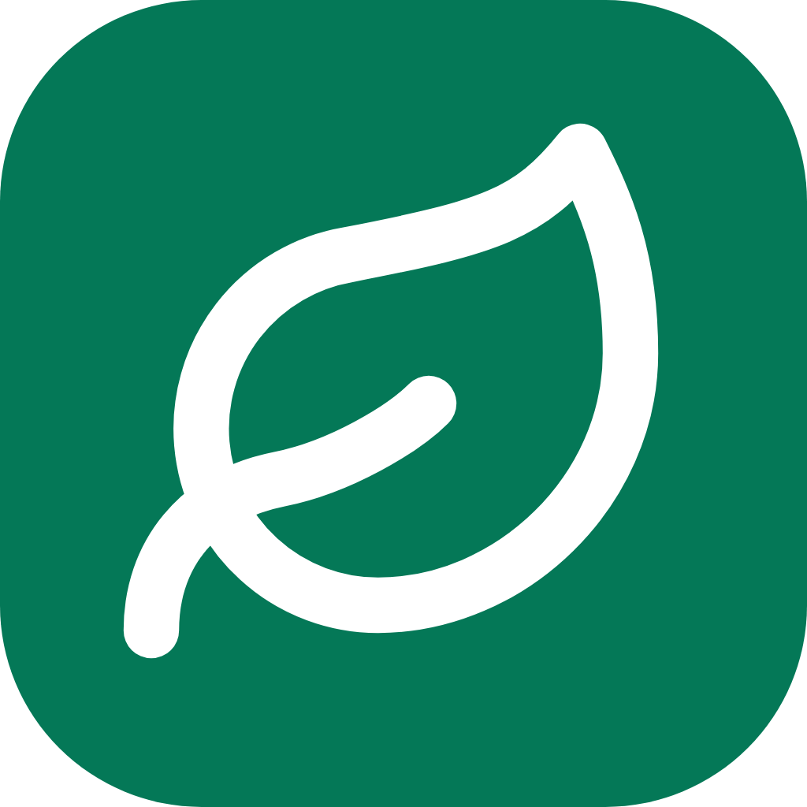
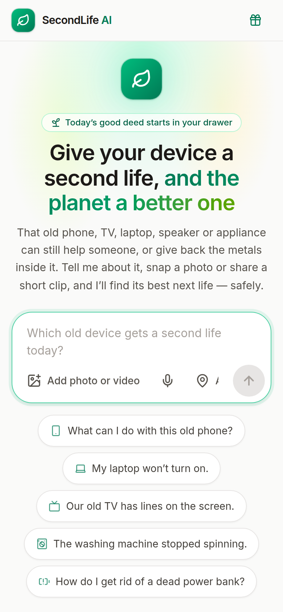
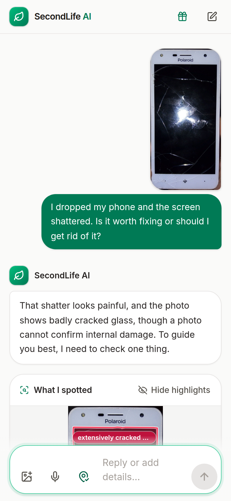
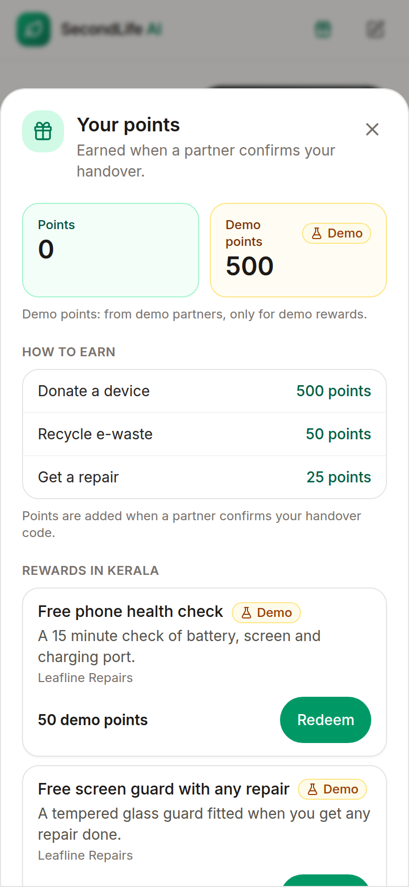
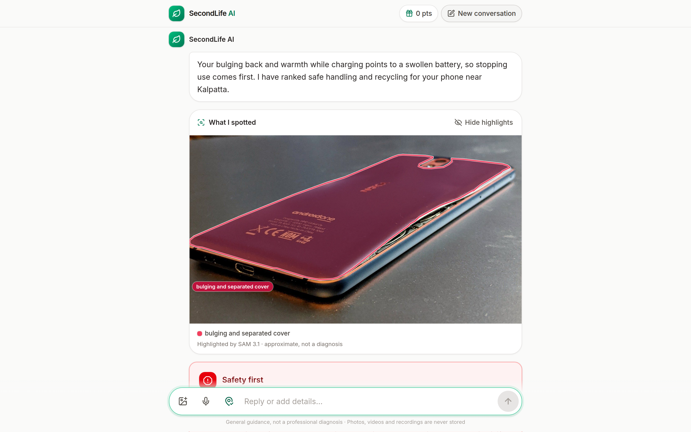
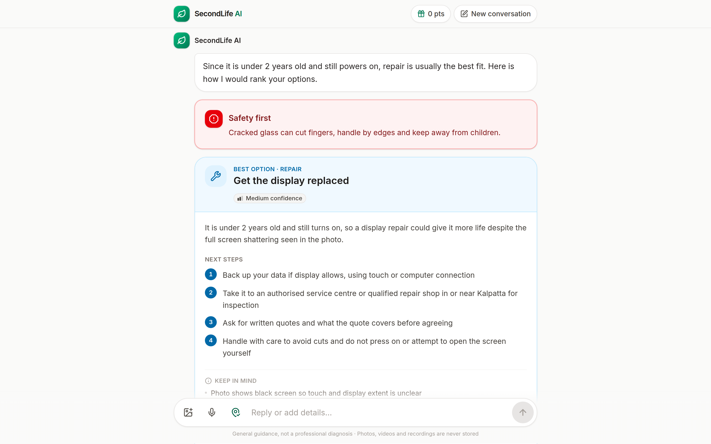
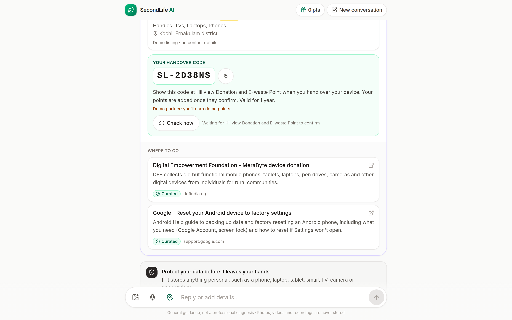
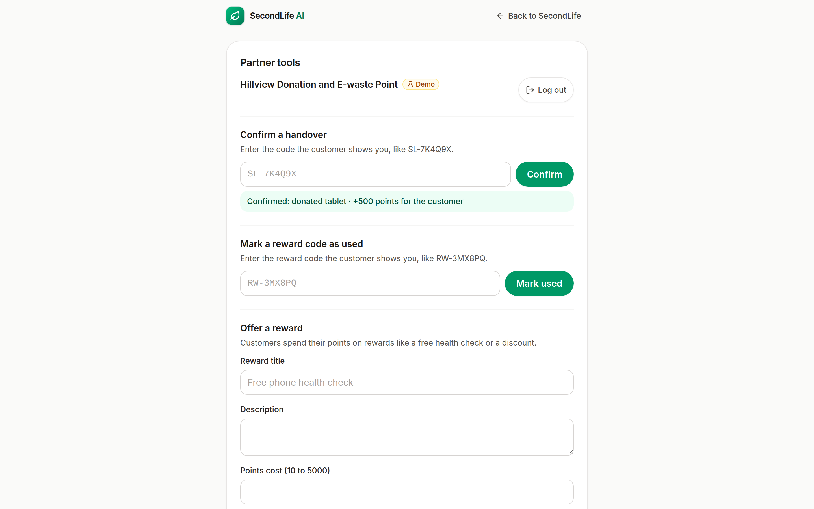
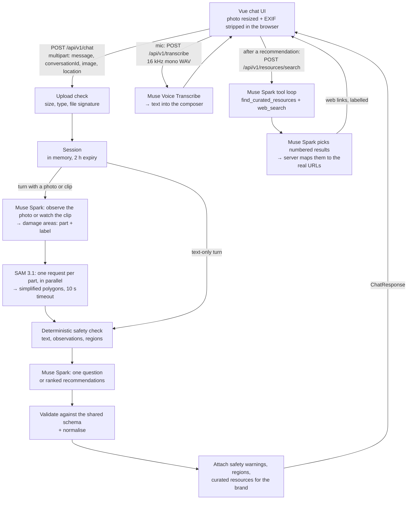

<div align="center">



# SecondLife AI

**Show it, say it or type it. SecondLife AI tells you whether to repair, reuse, donate, resell or recycle an old device, and how to do it safely.**

[](https://dev.meta.ai/events/global-hackathon)


[How it works](#how-it-works) · [Screenshots](#screenshots) · [Meta AI integration](#meta-ai-integration) · [Getting started](#getting-started) · [Limitations](#limitations-and-roadmap)

</div>

Old phones, chargers, TVs and appliances sit in drawers or go out with the general waste because their owners don't know what else to do with them. Is a cracked screen worth fixing? Is a swollen battery dangerous? Who will take an old washing machine? **SecondLife AI** answers those questions in a short conversation. It works for any electrical or electronic device, from earbuds to air conditioners, in English, Hindi or Hinglish. The MVP covers **India**.

- **Muse Spark** reads your photo or video clip, asks at most three questions and ranks your options. Each option has next steps, a confidence level and its limits.
- **SAM 3.1** outlines the damage on your own photo, so you can see what the assistant saw.
- **Muse Voice Transcribe** lets you speak instead of typing.
- A **safety layer that works independently of the model** puts "stop using it" first when it sees a swollen battery, sparks or shocks.
- **Trusted next steps:** curated official links, web results the model can't make up, and nearby repair and e-waste partners. When a partner confirms your handover, you earn **points to spend on rewards**.

<table>
  <tr>
    <td align="center" width="33%"></td>
    <td align="center" width="33%"></td>
    <td align="center" width="33%"></td>
  </tr>
  <tr>
    <td align="center"><sub>Type, speak, or add a photo or clip</sub></td>
    <td align="center"><sub>Muse Spark reads the photo and asks one question</sub></td>
    <td align="center"><sub>Points from partner handovers, spent on rewards (demo data)</sub></td>
  </tr>
</table>

> [!NOTE]
> **Status:** everything under [Features](#features) is built, and the AI features run on the live Meta Model API. The screenshots come from the running app. Video clips, voice input and Hindi have been tested against the API but not yet on real phones. Partner listings and rewards in the demo are fictional and labelled "Demo". A public deployment and a demo video are still to come.

## How it works

1. **Describe the device.** Type, tap the mic, or add a photo or a short clip. You can also try one of the bundled sample photos. "My laptop won't turn on" is enough to start.
2. **See what the assistant spotted.** The damage is outlined on your photo and labelled with the fault, such as "shattered glass across screen".
3. **Answer a question or two.** The assistant asks at most three, and only when the answer could change its advice. Each question comes with one-tap replies.
4. **Get ranked options.** The best option comes first and the alternatives follow. Each has a reason, numbered next steps, a confidence level and its limits. Safety warnings and a data-wipe checklist appear when they apply.
5. **Take the next step.** You get curated links for the device's brand, official pages found by web search a few seconds later, and partners in your district.
6. **Earn points.** Hand the device to a partner and show your one-time code. Once they confirm, the points land in your wallet, ready to spend on partner rewards.

## Screenshots

<table>
  <tr>
    <td width="50%"></td>
    <td width="50%"></td>
  </tr>
  <tr>
    <td><sub><b>Swollen battery.</b> SAM 3.1 outlines the lifted back cover and Muse Spark labels the fault.</sub></td>
    <td><sub><b>Ranked recommendation.</b> Safety first, then the best option with next steps and a confidence level.</sub></td>
  </tr>
  <tr>
    <td></td>
    <td></td>
  </tr>
  <tr>
    <td><sub><b>Handover code.</b> A one-time code for a nearby partner, with curated links below.</sub></td>
    <td><sub><b>Partner confirms.</b> The shop enters the code on the partner page, and the points are awarded.</sub></td>
  </tr>
</table>

Every screen, at desktop and mobile sizes, is in [`docs/screenshots/`](docs/screenshots/).

## Features

Everything in this section is implemented. Planned work is listed under [Roadmap](#roadmap).

### 🧠 Understanding the device

- **Photo and video understanding.** Muse Spark reads the photo or watches the clip and returns structured observations: the device type, a brand and model guess, its visible condition, possible hazards and each damaged area. It treats these as first impressions, never as a diagnosis.
- **Damage overlay.** SAM 3.1 outlines each damaged part on the user's own photo. The outlines are drawn as translucent, labelled masks on an SVG layer, and a toggle hides or shows them.
- **Bounded questioning.** The assistant asks at most three follow-up questions, one per turn, with quick-reply chips. If the user doesn't know an answer, it recommends anyway and states the uncertainty.
- **Ranked recommendations** across repair, reuse, donate, resell, recycle and "stop using it". The top option gets a primary card, and the alternatives get expandable cards. After a recommendation, the user can keep asking follow-up questions.
- **Strict response contract.** Every assistant turn is validated against one Zod schema shared by the server and the client, then normalised.

### 🎙️ Multimodal, multilingual input

- **Photos** by file picker, drag-and-drop or paste. The browser resizes each photo (longest side at most 1600 px) and re-encodes it as JPEG, which strips EXIF metadata such as GPS location. HEIC photos the browser can't open get a clear message.
- **Short video clips** (MP4 or MOV, up to 30 seconds and 20 MB) for problems a photo can't show, such as a flickering screen. Location and other personal metadata are removed on the device and again on the server.
- **Voice.** The mic button records up to a minute and converts the recording to WAV in the browser. Muse Voice Transcribe turns it into text, which the user can check and edit before sending.
- **English, Hindi and Hinglish.** Muse Spark replies in the language and script the user writes or speaks in.
- **Optional location, worked out on the device.** The browser's position is matched to the nearest Indian town, district and state using a bundled GeoNames table. Only those names are sent, never coordinates. Users can instead pick a state and type a city.
- **Three sample photos** (cracked phone, swollen battery, old tablet) let anyone try it without a broken device.

### 🛡️ Safety

- **A deterministic safety layer, independent of the model.** It detects battery, fire and electrical hazards (swelling, smoke, sparks, a burning smell, electric shocks, melted wiring, a battery or gas leak) in what the user writes, in the photo observations and in the highlighted regions. It understands Hindi and Hinglish ("battery phool gayi", "बैटरी फूल गई") and simple negation in both languages ("it's not hot", "garam nahi hai"). It also ignores everyday appliance complaints, such as an AC blowing hot air.
- **When it finds a hazard,** it always shows a safety banner and puts "stop using it" first. It also removes DIY battery advice from every reply.
- **Appliance rules in the model's instructions:** never open a microwave, a CRT TV or anything mains-powered, and leave fridge and AC refrigerant gas to technicians.
- **A privacy checklist** (back up, sign out, remove SIM and memory cards, factory reset) appears whenever donating or reselling a device that stores personal data is recommended.

### 🔗 Trusted resources

- **Curated links:** 57 hand-picked resources for India plus a few global guides, including official service and e-waste pages for 33 electronics and appliance brands. They appear under the recommendation they support. Brand-specific links show only when the device's brand is known and matches.
- **Web search with tool calling.** Muse Spark checks the curated list with a function tool, then searches the web only for the gaps. Results are labelled "Found on the web — check before visiting", with their source. The model never writes a link (see [why](#design-decisions)).
- **Partners near you.** Repair shops and drop-off points in the user's district and state appear under the repair, donate and recycle options. Real partners get call and WhatsApp buttons. The listings in this demo are fictional, always labelled "Demo", and have no contact details.

### 🎁 Partner points and rewards

- **Handover codes.** The user picks a partner and gets a one-time code (for example `SL-7K4Q9X`). When the partner enters it with their PIN, the user earns 500 points for a donation, 50 for recycling or 25 for a repair. Points are never awarded on the user's word alone.
- **Rewards.** Partners offer rewards, such as a free phone health check. Redeeming one gives a code that the partner marks as used.
- **Demo points are kept apart.** Demo partners award "demo points", which only buy demo rewards, so the public demo can't create points that a real shop would have to honour.
- **Partner page** (`#/partner`). Shops can ask to be listed, with explicit consent to show their name, area and phone number. They get a PIN, shown once, and their listing appears only after approval. Logged-in partners confirm handovers, mark reward codes as used and offer rewards. A "Try the demo" box lists the demo partners and their shared PIN.
- **Outcome recording.** Users can record whether they repaired, reused, donated, sold or recycled the device. Each choice gets a short celebration and a reminder of the next practical step.

### 💬 Experience

- A mobile-first chat with suggested prompts, a typing indicator, a "New conversation" button and a points button in the header.
- Inline errors come with a Retry button that resends the same message and photo. Expired conversations restart cleanly.

## Meta AI integration

SecondLife AI uses **Meta models only**. All of them run on the [Meta Model API](https://dev.meta.ai/docs) with one API key, and are called only from the server.

| Model | ID | API | Role in SecondLife AI |
|---|---|---|---|
| **Muse Spark** | `muse-spark-1.3` | Chat Completions | Reads photos and watches clips. Asks follow-up questions and returns ranked recommendations as strict structured output |
| **Muse Spark** with tools | `muse-spark-1.3` | Responses | Runs a tool loop with the `find_curated_resources` function tool and the built-in `web_search` tool, to find official pages the curated list lacks |
| **SAM 3.1** | `sam-3.1` | Responses | Outlines the damaged parts that Muse Spark names, on the user's photo or on a frame from their clip |
| **Muse Voice Transcribe** | `muse-voice-transcribe-1.0` | ASR | Turns speech into editable text, with an English and Hindi language hint |

The [architecture diagram](#architecture) shows how one conversation turn chains them.

### Design decisions

Building on these models taught us a few things that shaped the design:

- **Outline the part, label the fault.** SAM 3.1 matches noun phrases that name parts, not defects. In our tests, "cracked phone screen" matched, but "crack" and "swollen battery" returned nothing. So Muse Spark returns each damaged area as two fields. The `part` is what SAM 3.1 outlines, such as "phone screen", "phone side frame", or "phone back cover" for a lifted back. The `label` is what the user sees, such as "bulging and separated cover".
- **The model never writes a link.** When asked to write URLs after a web search, Muse Spark produced plausible pages that weren't in the results. So the finder has it pick numbered search results, and the server uses each result's real URL.
- **Curated links first, web search for the gaps.** The `find_curated_resources` tool shows Muse Spark the hand-picked links before it searches. For appliance brands, web search mostly returns unofficial "service centre" sites, a common scam in India. The selection step rejects those, which is why the curated list carries official pages for 33 brands.
- **Safety doesn't depend on the model.** The hazard check is deterministic code that runs on every reply, whatever Muse Spark returns.
- **No training on users' photos.** We use `muse-spark-1.3`, not the "contributor" variants, which let Meta train on inputs. Every Responses API request is sent with `store: false`.
- **Fast enough to feel like a chat.** SAM 3.1 requests run in parallel, one per part. Web links are fetched after the recommendation appears, so the user isn't kept waiting.

<details>
<summary><b>How the code calls each model</b></summary>

<br>

Details confirmed from [Meta's developer docs](https://dev.meta.ai/docs):

- **Conversation:** the OpenAI-compatible Chat Completions endpoint (`POST /v1/chat/completions`). Photos go in as base64 data URLs. `response_format` carries a strict JSON schema generated from the shared Zod schemas: `DeviceObservations` for the photo and `AssistantTurn` for each reply. Replies are still validated, and an invalid one gets one repair request that lists the validation errors. Muse Spark always reasons, and the server asks for `reasoning_effort: "low"` to keep turns quick.
- **Segmentation:** SAM 3.1 runs on the Responses API (`POST /v1/responses`), with one streamed request per part (up to four, in parallel), compact `one_bit` masks and a confidence score for each match. Meta's [`@meta-sam/parser`](https://www.npmjs.com/package/@meta-sam/parser) decodes each mask. The server maps it from its bounding box back to image pixels, simplifies the outline, drops tiny fragments and keeps matches with a confidence of at least 0.5. Parts with the same name are merged, and their labels combined. The overlay draws holes correctly.
- **Tool calling and web search:** both run on the Responses API, because web search isn't available on Chat Completions. The resource finder (`server/src/providers/muse/resource-finder.ts`) works in two steps:
  1. A tool loop of at most a few rounds, with the `find_curated_resources` function tool and the built-in `web_search` tool. Search is biased to the user's state and town when they've shared them. `tool_choice` can only be `"auto"`, so the model decides when to call each tool.
  2. A selection call with structured output. The model sees the numbered search results and returns its picks as result numbers. The server maps each number to that result's URL. It keeps only official-looking picks for the recommended actions (at most two per action) and drops duplicates of the curated links.
- **Video:** clips go to Chat Completions inline, as a base64 `video_url` part, with the same structured `DeviceObservations` output as photos. Meta's docs say audio understanding in `muse-spark-1.3` isn't fully supported, so the prompt asks Muse Spark to rely on what's visible rather than the soundtrack. SAM 3.1 runs on a frame the browser takes from the middle of the clip.
- **Speech:** `POST /v1/asr/transcribe` in `PUSH_TO_TALK` mode, with a language hint of English and Hindi. A short list of brand and device keywords (such as "Redmi" and "swollen battery") improves recognition.
- **Reasoning between tool rounds** is carried as encrypted reasoning items.

</details>

## Architecture

One repository and one deployable Node service. Express serves the API and, in production, the built Vue app.



- **Frontend and backend.** The client calls a REST API under `/api/v1`. In development, Vite proxies `/api` to the Express server on port 3001. In production, Express also serves `client/dist`, so everything runs on one origin.
- **Swappable model hosts.** Three small interfaces in `server/src/providers/types.ts` wrap the models: `AssessmentProvider` (`observeImage`, `respond`) for Muse Spark, `SegmentationProvider` (`segment`) for SAM 3.1, and `ResourceFinder` (`find`) for web search.
- **Graceful degradation.** A segmentation or web search failure never blocks the conversation. The photo is shown without highlights, and the curated links stand on their own.
- **Partner programme storage.** Partners, wallets, handover codes and reward codes are saved to one JSON file in `DATA_DIR`. Partner PINs are stored only as salted scrypt hashes.

<details>
<summary><b>How a turn is produced</b> (<code>server/src/services/conversation.service.ts</code>)</summary>

<br>

1. Load the session, or create one if the ID is missing or expired. Work on a copy, so a failed request can be retried cleanly.
2. If there is a photo, get the device observations and send the named damage areas to segmentation (merged by part, up to four). Keep regions that score at least 0.5. A short summary of the regions is kept for later turns, but the image itself is never stored.
3. Run the safety check over the user's messages, the observations and the regions.
4. Ask the assessment provider for the next turn: a question (`gathering`), ranked recommendations (`recommending`), or an answer about an earlier recommendation (`follow_up`).
5. Validate and normalise the turn, apply the safety rules, and attach curated resources for the recommended actions and the device's brand. Then save the session and return.
6. After a recommending turn, the client calls `POST /resources/search` for extra official links and appends them when they arrive. The result is cached on the session until the next recommendation.

</details>

## Technology stack

| Layer | Technology |
|---|---|
| Frontend | Vue 3 (`<script setup>`), TypeScript, Vite 8 |
| Styling | Tailwind CSS 4, Lucide icons |
| Backend | Node.js 22, Express 5, Multer (in-memory uploads) |
| API contract | Zod 4 schemas in `shared/schemas.ts`, imported by both sides |
| AI | Meta models only, on the Meta Model API: Muse Spark (Chat Completions and Responses APIs), SAM 3.1 and Muse Voice Transcribe, called with plain `fetch`. Meta's `@meta-sam/parser` decodes SAM masks |
| Tooling | tsx (dev server), esbuild (server build), vue-tsc, concurrently |

## Getting started

### Prerequisites

- Node.js 22 or later, with npm
- A Meta Model API key

### Install and configure

```bash
git clone https://github.com/vonnue-akhil/SecondLife-AI.git
cd SecondLife-AI
npm install
cp .env.example .env
```

In `.env`, add your Meta Model API key as `MODEL_API_KEY`. Then switch on the Muse Spark and SAM 3.1 providers as described in [`.env.example`](.env.example) (`SEGMENTATION_PROVIDER=sam3` for SAM 3.1). Web search, video clips and the mic button turn on with Muse Spark, using the same key.

### Run

```bash
npm run dev
```

This starts both parts:

- Client (Vite): http://localhost:5173. Open this one.
- API (Express, auto-reloads): http://localhost:3001/api/v1/health

To run them separately, use `npm run dev:server` and `npm run dev:client` in two terminals.

### Try it

- Tap the **Cracked phone** sample photo and send it.
- Type "My laptop won't turn on".
- Type "The back of my phone is bulging" to see the safety layer.
- Tap the **Old tablet** sample photo, send "Still works, I just upgraded.", then record that you donated it.
- **The full points journey:**
  1. Set your area to Wayanad, Kerala, using the location button under the message box.
  2. Get a recommendation to donate or recycle, and tap **Get my handover code** at a demo partner.
  3. Open `#/partner` in another tab and log in as that demo partner with the demo PIN shown there (`demo-2026` by default).
  4. Confirm the code. Your demo points appear under the points button, ready to spend on a demo reward.

### Production build

```bash
npm run build
npm start
```

This serves the client and the API together on `PORT` (default 3001), at http://localhost:3001.

### Checks

```bash
npm run typecheck   # vue-tsc for the client, tsc for the server
```

There is no automated test suite.

<details>
<summary><b>Environment variables</b></summary>

<br>

Settings are read from `.env` in the repository root, and [`.env.example`](.env.example) lists every one. A blank value counts as unset. The server validates all values at startup and exits with a clear message if one is invalid. Never commit `.env`; it's already in `.gitignore`.

| Variable | Default | Purpose |
|---|---|---|
| `MUSE_HOST` | `meta` | Where Muse Spark runs: `meta` (Meta Model API) or `baseten` (Muse Spark Open) |
| `MODEL_API_KEY` | — | Meta Model API key, used for Muse Spark, web search, SAM 3.1 and Muse Voice Transcribe. Server-side only |
| `META_API_BASE_URL` | `https://api.meta.ai/v1` | Meta Model API base URL |
| `META_MODEL_ID` | `muse-spark-1.3` | Muse Spark model ID on the Meta host |
| `BASETEN_API_KEY` | — | Baseten API key. Server-side only |
| `BASETEN_BASE_URL` | `https://inference.baseten.co/v1` | Baseten base URL |
| `BASETEN_MODEL_ID` | `meta-models/muse-spark-open-1026` | Muse Spark Open model ID on Baseten (to be confirmed) |
| `SEGMENTATION_PROVIDER` | — | `sam3` outlines damage on any photo with SAM 3.1 on the Meta Model API (needs `MODEL_API_KEY`) |
| `SAM_MODEL_ID` | `sam-3.1` | SAM model ID on the Meta Model API |
| `ASR_MODEL_ID` | `muse-voice-transcribe-1.0` | Muse Voice Transcribe model ID for the mic button |
| `MAX_UPLOAD_MB` | `8` | Maximum image upload size (1–20) |
| `MAX_VIDEO_MB` | `20` | Maximum video clip size (1–40). Clips must also be at most 30 seconds |
| `DATA_DIR` | `data` | Folder for the partner programme's JSON data file (partners, wallets, handover and reward codes). Keep it on a persistent disk |
| `DEMO_PARTNER_PIN` | `demo-2026` | PIN for the fictional demo partners, shown on the partner page. Blank turns the demo partner tools off |
| `ADMIN_TOKEN` | — | Bearer token for approving partner registrations. Admin routes are off when it's unset |
| `PORT` | `3001` | Port for the API, and for the production server |

</details>

## API reference

All endpoints are under `/api/v1`. Errors use the shape `{ error: { code, message } }`, with a message that is safe to show users.

<details>
<summary><b>Endpoints</b></summary>

<br>

| Method | Path | Description |
|---|---|---|
| `GET` | `/health` | `{ ok, provider, isMock, supportsImages, supportsVideo, speechToText, webSearch }`, used for the header badge and to decide which inputs and extras to offer |
| `POST` | `/chat` | `multipart/form-data` with `message`, optional `conversationId`, optional `image`, optional `video` (MP4 or MOV, up to 30 s; `image` is then its poster frame) and optional `location` (JSON: `{ state, district, place, source }`, where `state` is a two-letter code such as `KL`; a malformed value is ignored). Returns the assistant turn, resources, damage regions and provider names |
| `GET` | `/resources?region=IN&action=recycle` | Curated resources, optionally filtered by region and action. A state region such as `IN-KL` also includes `IN` and global entries, most specific first |
| `POST` | `/resources/search` | `{ conversationId }`. Searches the web for official pages that the latest recommendation's curated links lack. Returns `{ resources, searched }`, where every resource has `source: "web"` and its URL comes from a real search result. Takes several seconds; repeat calls are served from the session |
| `POST` | `/transcribe` | `multipart/form-data` with one `audio` file: mono 16-bit PCM WAV at 16 or 24 kHz, up to 60 s. Returns `{ text }` |
| `GET` | `/partners?state=KL&district=Wayanad&service=repair` | Approved partners, same district first (at most 5 when a state is given) |
| `POST` | `/partners` | A partner registration (with `consent: true`). Returns `{ id, pin, status: "pending" }`. The PIN is shown once and stored only as a salted hash |
| `GET` | `/rewards?state=KL` | Rewards from approved partners, the user's state first |
| `GET` | `/wallet` | The wallet for the `X-Wallet-Id` header: `{ points, demoPoints, history }` |
| `POST` | `/handovers` | `{ action, partnerId, conversationId? }` with `X-Wallet-Id`. Returns a one-time code valid for 1 year |
| `GET` | `/handovers/:code` | The code's status (`open`, `confirmed`, `expired`), for its own wallet only |
| `POST` | `/rewards/:id/redeem` | Spends points (or demo points for a demo reward) and returns a reward code |
| `POST` | `/partner/login`, `/partner/handovers/confirm`, `/partner/redemptions/use`, `/partner/rewards` | Partner tools. Every request carries `{ partnerId, pin }`. Five wrong PINs in 10 minutes lock the partner out for a while |
| `GET` | `/partner/demo` | The demo partners and their shared PIN, for the "Try the demo" box |
| `GET`/`POST` | `/admin/partners`, `/admin/partners/:id/approve`, `/admin/partners/:id/reject` | Moderation of registrations, with `Authorization: Bearer <ADMIN_TOKEN>`. Off when `ADMIN_TOKEN` is unset |
| `POST` | `/outcomes` | Records `{ conversationId, outcome }` (`repaired`, `reused`, `donated`, `sold`, `recycled`, `undecided`) |

</details>

## Privacy and responsible AI

- **Nothing the user shares is kept.** Photos, clips and voice recordings are held in server memory for the current request only, and are never written to disk or logs. Transcripts aren't logged either.
- **Metadata is stripped on the device.** Photos are re-encoded in the browser, which removes EXIF data such as GPS location. Clips have their location and other personal metadata (`udta` and `meta` boxes) wiped in the browser before upload, and again on the server.
- **Location is optional and coarse.** The nearest town is looked up on the device. Only the town, district and state reach the server and the models, and the location isn't logged.
- **Meta keeps no copy.** Every Responses API request is sent with `store: false`, and the app avoids the Muse Spark variants that allow training on inputs.
- **Web search never sees what the user wrote.** It sees only structured facts: the device type, brand, town and state, and the recommended actions. Search snippets are treated as untrusted data.
- **Honest advice.** Image observations are first impressions, never a diagnosis. The assistant never states repair costs, resale prices, availability or environmental figures. Instead, it says what would determine them and how to find out.
- **Anonymous points.** The wallet is a random ID kept in the browser, with no name, phone number or login. Only partners' details are stored, with their consent.
- **Short-lived conversations.** Conversations live in server memory, expire after 2 hours of inactivity and keep the last 20 messages.

## Limitations and roadmap

### Limitations

- **Outlines show the damaged part, not the defect.** SAM 3.1 matches parts, so a cracked screen or a display fault gets the whole screen outlined rather than each crack or line. A bent phone gets its side frame outlined, and a swollen battery shows as the lifted back cover. The label on each outline names the actual problem. Some damage, such as a small dent, may not be outlined at all.
- **Video highlights cover one frame.** SAM 3.1 outlines damage on a single frame from the middle of a clip. If the browser can't decode the clip (for example, HEVC video on some desktop browsers), it's sent without a frame and nothing is outlined.
- **Web results vary.** The extra links depend on what the search returns, so a search may add nothing. For example, no State Pollution Control Board page has come back so far. Web links aren't hand-checked, and they're labelled as such.
- **Resources need checking.** The curated list was compiled from official pages but hasn't yet been hand-verified by the team. Services, coverage and terms can change. Brands outside the curated list get only general repair and recycling links.
- **Keyword brand detection.** The brand comes from Muse Spark's reading of the photo, or from brand and model names in the conversation. An unrecognised brand gets only brand-neutral links.
- **Demo partners and rewards are fictional.** Every demo listing and reward is labelled "Demo", and no real shops have joined yet. Real registrations wait for manual approval, and nothing checks a shop's identity beyond that.
- **Points live on one device.** The wallet is tied to the browser, so clearing browser data or switching phones loses the points. There are no accounts yet.
- **Simple storage.** Conversations and outcomes are kept in memory and lost when the server restarts. The partner programme uses one JSON file, which suits a single server instance only.
- **Pattern-based hazard detection.** It covers English, Hinglish and Hindi in Devanagari, and may miss unusual phrasing or other languages.
- **India only, partly bilingual.** Replies follow the user's language, but the interface is in English. Speech recognition doesn't support Malayalam, Gujarati, Punjabi, Odia or Urdu.
- **No state-level curated resources yet.** The data format supports them (`"region": "IN-KL"` in `resources.json`), but none have been added. A shared location shapes the advice and biases the web search, but doesn't change the curated links.
- **Approximate place names.** The nearest town comes from GeoNames towns with at least 5,000 people, so a suburb may show as a neighbouring town. Some district names use older spellings, such as "Bangalore Urban".
- **No automated tests, and no rate limiting** beyond the partner PIN lockout.

### Roadmap

**Next up**

- Deploy a public demo and publish a demo video.
- Test video, voice and Hindi on real phones.
- Curate State Pollution Control Board recycler lists for the larger states.

**Later**

- An on-device privacy mode with Muse Glimmer.
- Accounts, so points move between devices, and persistent storage.
- Interface translations, more Indian languages, more regions and more resources.

## Project structure

<details>
<summary><b>Repository layout</b></summary>

<br>

```
.
├── client/                    Vue app
│   ├── public/samples/        Sample photos and their credits (CREDITS.md)
│   └── src/
│       ├── App.vue            Layout: landing vs conversation, drag-and-drop and paste
│       ├── components/        Composer, messages, damage overlay, recommendation cards,
│       │                      safety banner, resource links, outcome picker, …
│       ├── composables/       Conversation, composer and location state
│       ├── data/              india-places.json: offline town → district → state table (generated)
│       └── lib/               API client, image processing, on-device place lookup, display helpers, sample list
├── server/src/
│   ├── index.ts, app.ts       Entry point; Express app, /api/v1 routes, production static hosting
│   ├── config.ts              Validated environment configuration and constants
│   ├── routes/                health, chat, resources, outcomes
│   ├── middleware/            Upload validation, error responses
│   ├── providers/             Provider interfaces and implementations; meta-responses.ts is the Responses API client
│   │   ├── muse/              Muse Spark: Chat Completions client, prompts, resource finder (tools + web search)
│   │   ├── sam/               SAM 3.1: segmentation requests and mask-to-polygon conversion
│   │   └── voice/             Muse Voice Transcribe client
│   ├── services/              Conversation flow, response validation, safety, resources, brand detection, sessions,
│   │                          partners, points and the JSON data store
│   └── data/                  Curated resources, demo partners and rewards, sample-photo data
├── shared/
│   ├── schemas.ts             API contract: Zod schemas and inferred types
│   ├── india-states.ts        The 36 states and union territories with their two-letter codes
│   └── mp4.ts                 MP4/MOV duration check and metadata removal, used by the browser and the server
├── scripts/
│   └── build-india-places.ts  Regenerates client/src/data/india-places.json from GeoNames
├── docs/screenshots/          App screenshots used in this README
└── .env.example               Every server setting, documented
```

</details>

## Contributing

- Branch from `main` and keep each change focused.
- SecondLife AI uses Meta models only. Model calls go through the provider interfaces in `server/src/providers/types.ts`.
- `shared/schemas.ts` is the API contract. Change the schemas there first, then update the server and the client.
- Curated resources live in `server/src/data/resources.json` and are validated at startup. Add only official or verified URLs.
- Run `npm run typecheck` before opening a pull request.
- Never commit `.env` files, API keys or other credentials.

## License

No license has been chosen for the code yet. The sample photos keep their own licences (public domain and CC BY-SA); see [`client/public/samples/CREDITS.md`](client/public/samples/CREDITS.md). The town and district table in `client/src/data/india-places.json` is derived from [GeoNames](https://www.geonames.org/) data, licensed under [CC BY 4.0](https://creativecommons.org/licenses/by/4.0/).

## Hackathon

SecondLife AI was built for the **Meta Global AI Developer Hackathon**, a remote event run by Meta with Cerebral Valley from 26 October to 4 November 2026.

- [Hackathon page (Meta)](https://dev.meta.ai/events/global-hackathon)
- [Event page (Cerebral Valley)](https://cerebralvalley.ai/e/meta-ai-developer-hackathon)
- [Meta developer documentation](https://dev.meta.ai/docs/)
