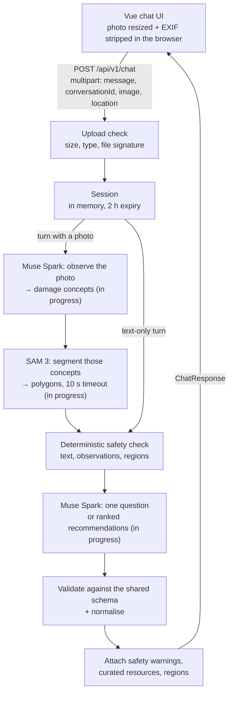

# SecondLife AI ♻️

An AI assistant that helps people decide what to do with an old electronic device: **repair, reuse, donate, resell or recycle**. Describe the device or upload a photo, answer a few questions, and get ranked recommendations, safety guidance and links to trusted resources. The MVP focuses on **India**.

SecondLife AI is being built for the [Meta Global AI Developer Hackathon](#hackathon) and uses **Meta models only**: Muse Spark for reasoning and SAM 3 for highlighting damage on the user's photo.

> **Status:** the chat experience, safety layer and resources are built. The Muse Spark and SAM 3 integrations are in progress, so the assistant's replies are not generated by a model yet.

## The problem

Old phones, laptops and tablets end up in drawers or in general waste because their owners don't know what else to do with them. Is a cracked screen worth fixing? Will anyone buy a phone that won't turn on? Is a swollen battery dangerous? Where is an authorised e-waste recycler? Without clear answers, devices that could be repaired, reused, donated or resold are thrown away, and hazardous ones are handled unsafely.

## The solution

SecondLife AI turns that decision into a short conversation:

1. **Describe the device, upload a photo, or both.** "My laptop won't turn on" is enough to start.
2. **See what the assistant spotted.** On a photo, damage such as a screen crack or a swollen battery is outlined directly on the image.
3. **Answer a question or two.** The assistant asks at most three, and only when the answer could change its advice. Each comes with one-tap quick replies.
4. **Get ranked recommendations.** Each option includes a reason, numbered next steps, a confidence level and its limitations.
5. **Take the next step.** Curated repair, resale, donation and recycling resources appear under the relevant recommendation, and you can record what you decided to do.

## Key features

### Implemented

- **Chat workspace** with suggested prompts, quick-reply chips, a typing indicator, follow-up questions after a recommendation, a "New conversation" control and a model badge in the header. Built mobile-first.
- **Photo upload** by file picker, drag-and-drop or paste. The browser resizes the photo (longest side at most 1600 px) and re-encodes it as JPEG, which strips EXIF metadata such as GPS location. HEIC photos the browser can't open get a clear message. The server checks size, type and file signature, and keeps images in memory only.
- **Optional location, worked out on the device.** "Use my current location" asks the browser for its position, then finds the nearest Indian town, its district and its state on the device, using a bundled GeoNames table that loads only when needed. Only the town, district and state are sent, never coordinates, and positions outside India are refused. Users can instead pick a state and type a city. The area is remembered on the device until removed, passed to the assistant as context, and used to put state-specific resources first.
- **Damage overlay.** Damage regions are drawn as translucent, labelled masks on an SVG layer over the user's own photo, with a hide/show toggle. Three bundled sample photos (cracked phone, swollen battery, old tablet) let you try it without a broken device.
- **Bounded questioning.** At most three follow-up questions, one per turn. If the user doesn't know an answer, the assistant recommends anyway and states the uncertainty.
- **Ranked recommendations** across repair, reuse, donate, resell, recycle and "stop using it": a primary card for the top option and expandable cards for alternatives.
- **Deterministic safety layer**, independent of the model. It detects battery and fire hazards in what the user writes (with simple negation handling, so "it's not hot" doesn't trigger), in the photo observations and in highlighted regions. On a match it always shows a safety banner and puts "stop using it" first. It removes DIY battery advice from every reply.
- **Privacy reminder** (back up, sign out, remove SIM and memory cards, factory reset) whenever donating or reselling is recommended.
- **Curated resources** for India plus a few global guides, shown under the recommendation they support and labelled as curated. The assistant never writes links itself.
- **Outcome recording.** Users can record whether they repaired, reused, donated, sold or recycled the device, or are still deciding. A choice is acknowledged with a short celebration, a note on why it helps, and a reminder of the next practical step (such as wiping data before donating).
- **Strict response contract.** Every assistant turn is validated against one Zod schema shared by the server and the client, then normalised.
- **Resilient UX.** Inline errors with a Retry button that resends the same message and photo. Expired conversations restart cleanly.

### Planned

- **Muse Spark** (`muse-spark-1.3` on the Meta Model API): reading the photo, choosing which damage to look for, asking follow-ups and returning ranked recommendations as structured output. The provider for this is written but has not yet been tested against the live API. Tool calls and web search for cited local resources come after that.
- **SAM 3** on a Modal serverless GPU (`sam3-modal/`): segmenting the damage Muse Spark names, on any user photo.
- Public deployment, screenshots and a demo video.

## Screenshots and demo

| | |
|---|---|
| Screenshots | Not added yet |
| Live demo | Not deployed yet |
| Demo video (3 min) | Not recorded yet |

## Technology stack

| Layer | Technology |
|---|---|
| Frontend | Vue 3 (`<script setup>`), TypeScript, Vite 8 |
| Styling | Tailwind CSS 4, Lucide icons |
| Backend | Node.js 22, Express 5, Multer (in-memory uploads) |
| API contract | Zod 4 schemas in `shared/schemas.ts`, imported by both sides |
| AI | Meta models only: Muse Spark and SAM 3 (integration in progress) |
| Tooling | tsx (dev server), esbuild (server build), vue-tsc, concurrently |

## Architecture

One repository and one deployable Node service: Express serves the API and, in production, the built Vue app.



**Frontend and backend.** The client calls a REST API under `/api/v1`. In development, Vite proxies `/api` to the Express server on port 3001. In production, Express also serves `client/dist`, so everything runs on one origin.

**AI providers.** Two small interfaces in `server/src/providers/types.ts` keep the models swappable per host: `AssessmentProvider` (`observeImage`, `respond`) for Muse Spark, and `SegmentationProvider` (`segment`) for SAM 3. Model calls happen on the server only, so credentials never reach the browser. A segmentation failure never blocks the conversation; the photo is simply shown without highlights.

**How a turn is produced** (`server/src/services/conversation.service.ts`):

1. Load the session, or create one if the ID is missing or expired. Work on a copy, so a failed request can be retried cleanly.
2. If there is a photo: get device observations, send the named damage concepts to segmentation, and keep regions scoring at least 0.5. A short summary of the regions is kept for later turns. The image itself is never stored.
3. Run the safety check over the user's messages, the observations and the regions.
4. Ask the assessment provider for the next turn: a question (`gathering`), ranked recommendations (`recommending`) or an answer about an earlier recommendation (`follow_up`).
5. Validate and normalise the turn, apply the safety rules, attach curated resources for the recommended actions, save the session and return.

### API

All endpoints are under `/api/v1`. Errors use the shape `{ error: { code, message } }` with a user-safe message.

| Method | Path | Description |
|---|---|---|
| `GET` | `/health` | `{ ok, provider, isMock, supportsImages }`, used for the header badge |
| `POST` | `/chat` | `multipart/form-data` with `message`, optional `conversationId`, optional `image` and optional `location` (JSON: `{ state, district, place, source }`, where `state` is a two-letter code such as `KL`; a malformed value is ignored). Returns the assistant turn, resources, damage regions and provider names |
| `GET` | `/resources?region=IN&action=recycle` | Curated resources, optionally filtered by region and action. A state region such as `IN-KL` also includes `IN` and global entries, most specific first |
| `POST` | `/outcomes` | Records `{ conversationId, outcome }` (`repaired`, `reused`, `donated`, `sold`, `recycled`, `undecided`) |

## Getting started

### Prerequisites

- Node.js 22 or later
- npm (included with Node.js)

### Install

```bash
git clone https://github.com/vonnue-akhil/SecondLife-AI.git
cd SecondLife-AI
npm install
```

### Configure

```bash
cp .env.example .env
```

Every setting has a working default. The Muse Spark and SAM 3 settings will be needed once those integrations are complete.

### Run in development

```bash
npm run dev
```

This starts both parts:

- Client (Vite): http://localhost:5173. Open this one.
- API (Express, auto-reloads): http://localhost:3001/api/v1/health

To run them separately in two terminals: `npm run dev:server` and `npm run dev:client`.

Try the four demo journeys:

- Tap the **Cracked phone** sample photo and send it.
- Type "My laptop won't turn on".
- Type "The back of my phone is bulging".
- Tap the **Old tablet** sample photo and send "Still works, I just upgraded.", then record that you donated it.

### Production build

```bash
npm run build
npm start
```

This serves the client and the API together on `PORT` (default 3001), at http://localhost:3001.

### Checks

```bash
npm run typecheck   # vue-tsc for the client, tsc for the server
```

There is no automated test suite.

## Environment variables

Settings are read from `.env` in the repository root; [`.env.example`](.env.example) lists every one. A blank value counts as unset. Never commit `.env`; it is already in `.gitignore`. The server validates all values at startup and exits with a clear message if one is invalid.

| Variable | Default | Purpose |
|---|---|---|
| `MUSE_HOST` | `meta` | Where Muse Spark runs: `meta` (Meta Model API) or `baseten` (Muse Spark Open) |
| `MODEL_API_KEY` | — | Meta Model API key. Server-side only |
| `META_API_BASE_URL` | `https://api.meta.ai/v1` | Meta Model API base URL |
| `META_MODEL_ID` | `muse-spark-1.3` | Muse Spark model ID on the Meta host |
| `BASETEN_API_KEY` | — | Baseten API key. Server-side only |
| `BASETEN_BASE_URL` | `https://inference.baseten.co/v1` | Baseten base URL |
| `BASETEN_MODEL_ID` | `meta-models/muse-spark-open-1026` | Muse Spark Open model ID on Baseten (to be confirmed) |
| `SAM3_HOST` | `modal` | Where SAM 3 runs: `modal` (this repo's Modal app) or `hosted` (a third-party endpoint) |
| `SAM3_API_URL` | — | SAM 3 endpoint URL |
| `SAM3_API_KEY` | — | Bearer token for the SAM 3 endpoint |
| `MAX_UPLOAD_MB` | `8` | Maximum image upload size (1–20) |
| `PORT` | `3001` | Port for the API, and for the production server |

## AI integration

### Models

SecondLife AI uses **Meta models only**, chained in one bounded loop:

| Role | Meta model | Planned use |
|---|---|---|
| Reasoning and conversation | Muse Spark | Reads the photo, asks follow-ups, returns ranked recommendations as structured output |
| Tool use | Muse Spark tool calling | `lookupCuratedResources(region, actions)` and `getSafetyGuidance(hazard)` |
| Grounded resources | Muse Spark web search | Local repair, donation and recycling options, accepted only with a citation |
| Damage localisation | SAM 3 | Segments the damage concepts Muse Spark names, for the photo overlay |

The integrations are in progress. The Muse Spark provider is written but has not yet been tested against the live Meta Model API. These details are confirmed from [Meta's developer docs](https://dev.meta.ai/docs), with how the code uses them:

- **Model:** `muse-spark-1.3`, the version Meta recommends for new work. We avoid the cheaper "contributor" variants, which allow Meta to train on what is sent, because requests include users' photos.
- **Endpoint:** the OpenAI-compatible Chat Completions endpoint, `POST https://api.meta.ai/v1/chat/completions`, with a bearer token. The server calls it with plain `fetch`.
- **Photos:** sent as a base64 data URL in an `image_url` part of the user message.
- **Structured output:** `response_format` with a strict JSON schema generated from the shared Zod schemas (`DeviceObservations` for the photo, `AssistantTurn` for each reply). Replies are still validated, and an invalid one gets one repair request listing the validation errors.
- **Reasoning:** Muse Spark always reasons. The server asks for `reasoning_effort: "low"` to keep turns quick.
- **Tool calling:** supported on Chat Completions (`tool_choice` must be `"auto"`). Not used yet.
- **Web search:** a built-in tool on Meta's Responses API only, with citations returned as URL annotations. Not used yet.

### What is already in place

- The provider interfaces and the response contract (`AssistantTurn` in `shared/schemas.ts`), which both providers must satisfy.
- The Muse Spark provider (`server/src/providers/muse/`): prompts, photo observations and conversation turns through structured output, one repair request for an invalid reply, and timeouts that fit within the browser's 70-second limit.
- Validation and normalisation of every turn, plus a parser for raw model output that strips code fences and stray text before validating.
- The deterministic safety layer and curated resources, which run whatever a model returns.

### Safety and privacy

- Hazard handling runs on the server for every reply, regardless of what the model returns.
- Image observations are treated as preliminary impressions, never as a diagnosis.
- The assistant never states repair costs, resale prices, availability or environmental figures. It says what would determine them and how to find out.
- Images are resized and stripped of metadata in the browser, held in server memory for the current request only, and never written to disk or logs.
- Conversations live in server memory, expire after 2 hours of inactivity and keep the last 20 messages.
- Location is optional and coarse. The nearest town is looked up on the device, and only the town, district and state reach the server and the model. The location is not logged.

## Project structure

```
.
├── client/                    Vue app
│   ├── public/samples/        Sample photos and their credits (CREDITS.md)
│   └── src/
│       ├── App.vue            Layout: landing vs conversation, drag-and-drop and paste
│       ├── components/        Composer, messages, damage overlay, recommendation cards,
│       │                      safety banner, resource links, outcome picker, …
│       ├── composables/       Conversation, composer and location state
│       ├── data/              india-places.json: offline town → district → state table (generated)
│       └── lib/               API client, image processing, on-device place lookup, display helpers, sample list
├── server/src/
│   ├── index.ts, app.ts       Entry point; Express app, /api/v1 routes, production static hosting
│   ├── config.ts              Validated environment configuration and constants
│   ├── routes/                health, chat, resources, outcomes
│   ├── middleware/            Upload validation, error responses
│   ├── providers/             AssessmentProvider and SegmentationProvider interfaces and implementations
│   │   └── muse/              Muse Spark: Chat Completions client and prompts
│   ├── services/              Conversation flow, response validation, safety, resources, session store
│   └── data/                  Curated resources and sample-photo data
├── shared/
│   ├── schemas.ts             API contract: Zod schemas and inferred types
│   └── india-states.ts        The 36 states and union territories with their two-letter codes
├── scripts/
│   └── build-india-places.ts  Regenerates client/src/data/india-places.json from GeoNames
└── .env.example               Every server setting, documented
```

## Limitations and future improvements

### Current limitations

- **Meta integration in progress.** The Muse Spark provider has not yet been tested against the live Meta API, so replies are not generated by a model yet.
- **Damage highlights only on the sample photos.** Until SAM 3 is connected, the overlay appears only on the three bundled sample photos.
- **Resources need checking.** The curated list was compiled from official pages but has not yet been hand-verified by the team. Services, coverage and terms can change.
- **No prices.** The assistant does not estimate repair costs or resale prices.
- **In-memory storage.** Conversations and outcomes are lost when the server restarts, and it runs as a single instance.
- **Pattern-based hazard detection.** Designed for English text and may miss unusual phrasing.
- **India only.** The UI is English-only and resources cover India plus a few global guides.
- **No state-level resources yet.** State-specific resources are supported (`"region": "IN-KL"` in `resources.json`), but none have been added yet, so a shared location currently changes the assistant's advice, not the links shown.
- **Approximate place names.** The nearest town comes from GeoNames towns with at least 5,000 people, so a suburb may show as a neighbouring town, and some district names use older spellings (e.g. "Bangalore Urban").
- **No automated tests or rate limiting.**

### Next up

- Test Muse Spark against the live Meta Model API, then add tool calling and web search for cited local resources.
- SAM 3 integration through the existing segmentation interface.
- Deploy a public demo and add screenshots and a demo video.

### Later ideas

- An on-device privacy mode with Muse Glimmer.
- Persistent storage, Indian-language support, more regions and resources.

## Contributing

- Branch from `main` and keep each change focused.
- SecondLife AI uses Meta models only. Model calls go through the provider interfaces in `server/src/providers/types.ts`.
- `shared/schemas.ts` is the API contract. Change the schemas there first, then update the server and the client.
- Curated resources live in `server/src/data/resources.json` and are validated at startup. Add only official or verified URLs.
- Run `npm run typecheck` before opening a pull request.
- Never commit `.env` files, API keys or other credentials.

## License

No license has been chosen for the code yet. The sample photos keep their own licences (public domain and CC BY-SA); see [`client/public/samples/CREDITS.md`](client/public/samples/CREDITS.md). The town and district table in `client/src/data/india-places.json` is derived from [GeoNames](https://www.geonames.org/) data, licensed under [CC BY 4.0](https://creativecommons.org/licenses/by/4.0/).

## Hackathon

SecondLife AI is being built for the **Meta Global AI Developer Hackathon**, a remote event run by Meta with Cerebral Valley from 26 October to 4 November 2026.

- [Hackathon page (Meta)](https://dev.meta.ai/events/global-hackathon)
- [Event page (Cerebral Valley)](https://cerebralvalley.ai/e/meta-ai-developer-hackathon)
- [Meta developer documentation](https://dev.meta.ai/docs/)
